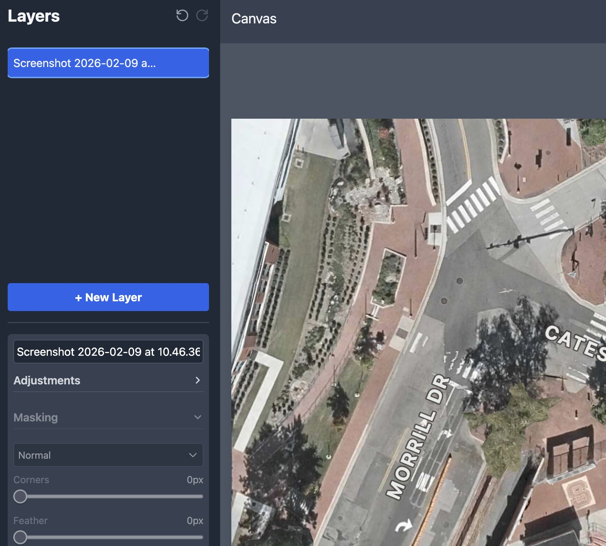

# AI Photo Editor

A powerful, browser-based, layer-driven photo editor built with React and enhanced with the generative capabilities of image-editing models via the OpenRouter API. This application provides a desktop-like editing experience in the browser, allowing for non-destructive editing through a layer-based workflow.

**Live Application: [https://image-editor-five-beta.vercel.app/](https://image-editor-five-beta.vercel.app/)**

-----

## ✨ Key Features

This project combines a robust set of standard photo editing tools with cutting-edge AI functionality.

### Core Editing Workflow

  * **Layer-Based System**: Add, delete, rename, and reorder layers for complex compositions. The base image acts as the background.
  * **Non-Destructive Adjustments**: Tweak brightness, contrast, saturation, hue, and blur for any selected layer or for the base image independently.
  * **Transform Tools**: Easily move and scale layers directly on the canvas with interactive handles.
  * **Masking & Blending**: Apply corner rounding and feathering to layers. Choose from 16 different blend modes (Multiply, Screen, Overlay, etc.) to control how layers interact.
  * **Cropping**: A simple and intuitive crop tool for trimming individual layers.
  * **HEIC Support**: Automatically converts and handles `.heic` and `.heif` image files from Apple devices.

### 🤖 AI-Powered Editing (OpenRouter)

  * **Model Choice**: Pick between multiple image-editing models (Nano Banana 2.1, Nano Banana Pro, GPT-5.4 Image 2, and more), each with an estimated cost per generation shown from live OpenRouter pricing.
  * **In-painting and Out-painting**: Select any layer (or the base image) and use a simple text prompt to completely transform it.
  * **Creative Generation**: Change backgrounds, alter objects, modify styles, or generate entirely new elements within a layer. For example, select a layer with a person and prompt "make them wear a superhero costume."
  * **Smart Feathering**: AI-edited layers automatically have a subtle feather applied to help them blend more naturally into the composition.

### User Experience

  * **Full Undo/Redo**: Complete history tracking allows you to step backward and forward through every action.
  * **Persistent Settings**: Your OpenRouter API key and default panel layouts are saved in your browser's local storage.
  * **Drag & Drop**: Add new images by simply dragging them onto the window from your desktop.
  * **Helpful UI**: Toast notifications provide feedback on actions, and a loading overlay indicates when the AI is working.
  * **Keyboard Shortcuts**: Boost your productivity with intuitive hotkeys for common actions.

-----

## 🚀 How to Use

1.  **Visit the Website**: Open the [live application link](https://image-editor-five-beta.vercel.app/).
2.  **Upload a Base Image**: Drag and drop an image file onto the window, or use the "Choose File" button.
3.  **Add More Layers**: Once the base image is loaded, you can add more images as new layers on top.
4.  **Select & Edit**: Click on any layer in the right-hand panel (or the base image) to select it.
5.  **Adjust**: Use the "Adjustments" and "Masking" panels in the sidebar to modify the selected layer.
6.  **Transform**: Click and drag a layer on the canvas to move it. Drag the corner handles to scale it.
7.  **Use AI Edit**:
      * First, go to **Settings (⚙️ icon)** and enter your OpenRouter API key.
      * Select a layer and click the **AI Edit** button.
      * Enter a prompt describing the change you want (e.g., "change the background to a snowy forest") and press **Generate**.
8.  **Download**: Click "Download Image" to save the final composition as a PNG file, or use the "Download" button in the layer panel to save just the selected layer.

-----

## ⌨️ Keyboard Shortcuts

| Action | Mac Shortcut | Windows/Linux Shortcut |
| :--- | :---: | :---: |
| **Undo** | `⌘` + `Z` | `Ctrl` + `Z` |
| **Redo** | `⌘` + `Shift` + `Z` | `Ctrl` + `Shift` + `Z`|
| **Duplicate Layer** | `⌘` + `D` | `Ctrl` + `D` |
| **Delete Layer** | `Delete` or `Backspace` | `Delete` or `Backspace` |
| **AI Edit** | `⌘` + `E` | `Ctrl` + `E` |
| **Toggle Crop Mode** | `Spacebar` | `Spacebar` |

-----

## 🛠️ Setting Up the AI Features

The AI editing capabilities are powered by the OpenRouter API. To use this feature, you need an OpenRouter API key with credits.

1.  Go to **[OpenRouter](https://openrouter.ai/)**.
2.  Sign in and add credits to your account.
3.  Go to **Settings → Keys** and create a new API key (`sk-or-v1-...`).
4.  Copy the generated API key.
5.  In this application, click the **Settings (⚙️) icon** in the top right.
6.  Paste your key into the "OpenRouter API Key" field and click **"Save and Close"**.

Your key will be saved in your browser's local storage for future use.

-----

## 💻 Running Locally

To run this project on your own machine:

1.  **Clone the repository:**

    ```bash
    git clone <repository-url>
    ```

2.  **Navigate to the project directory:**

    ```bash
    cd <project-directory>
    ```

3.  **Install dependencies:**

    ```bash
    npm install
    ```

4.  **Start the development server:**

    ```bash
    npm run dev
    ```

The application will now be running on `http://localhost:5173` (or another port if 5173 is busy).

-----

## 🔧 Tech Stack

  * **Framework**: [React](https://react.dev/)
  * **Styling**: [Tailwind CSS](https://tailwindcss.com/)
  * **AI Models**: [OpenRouter](https://openrouter.ai/) (Nano Banana family, GPT Image family)
  * **HEIC Conversion**: [heic2any](https://github.com/alexcorvi/heic2any)
  * **Deployment**: [Vercel](https://vercel.com/)
